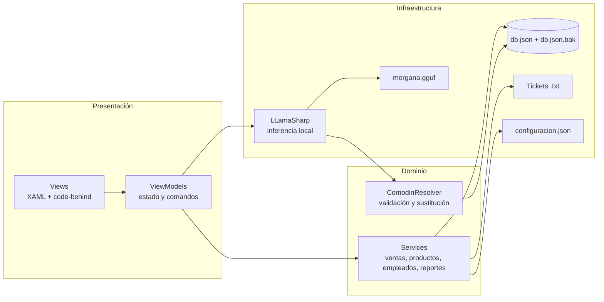

# ☕ Cafetería Leblanc — Punto de venta con IA local

> Aplicación de escritorio para operar una cafetería: ventas, inventario, empleados, reportes y un asistente virtual que funciona **sin internet**, dentro del mismo proceso de la aplicación.

**Stack principal:** WinUI 3 · .NET 8 · CommunityToolkit.Mvvm · JSON · LLamaSharp · Qwen2.5-1.5B-Instruct + LoRA

| Dato | Valor |
|---|---|
| Versión | 1.0.0 |
| Plataforma | Windows 10 1809+ / Windows 11, x64 (también x86 y ARM64) |
| Interfaz | WinUI 3, tema claro, español de México |
| Persistencia | `Documents\CafeteriaPOS\Data\db.json` |
| Asistente | Morgana, modelo GGUF local de ~940 MB |
| Estado | Funcional; documentación técnica y manual incluidos |

---

## Índice

1. [Descripción general](#1-descripción-general)
2. [Arquitectura y tecnologías](#2-arquitectura-y-tecnologías)
3. [Estructura del proyecto](#3-estructura-del-proyecto)
4. [Guía de configuración e instalación](#4-guía-de-configuración-e-instalación)
5. [Uso y funcionalidades](#5-uso-y-funcionalidades)
6. [Decisiones de diseño y notas técnicas](#6-decisiones-de-diseño-y-notas-técnicas)
7. [Documentación adicional](#7-documentación-adicional)
8. [Conclusiones del equipo](#8-conclusiones-del-equipo)
9. [Referencias](#9-referencias)
10. [Créditos y descargo](#10-créditos-y-descargo)

---

## 1. Descripción general

**Cafetería Leblanc POS** es un sistema de punto de venta de escritorio pensado para una cafetería pequeña o mediana. Resuelve el ciclo operativo completo:

- autenticación de empleados por usuario y contraseña;
- venta de productos con carrito, propina, pago en efectivo o tarjeta y cálculo de cambio;
- descuento automático de inventario y alertas de stock bajo;
- alta, edición y eliminación de productos, categorías y empleados;
- reportes del día, ranking de productos, propinas por empleado y resumen de los últimos siete días;
- exportación de reportes a CSV y JSON;
- generación de tickets de venta en texto plano;
- asistente conversacional **Morgana**, que consulta los datos reales del negocio sin enviar información a la nube.

### 1.1 Propósito

El objetivo es que una persona sin formación técnica pueda operar la caja y consultar la información del negocio desde una sola aplicación, con una curva de aprendizaje corta y sin depender de servicios externos. La IA se incorpora como un apoyo para consultar precios, stock, ventas, propinas y horarios en lenguaje natural, no como un reemplazo de las reglas del sistema.

### 1.2 Casos de uso principales

| Caso de uso | Actor | Resultado esperado |
|---|---|---|
| Abrir turno e iniciar sesión | Administrador / Cajero | Sesión activa con permisos según el puesto |
| Registrar una venta | Cajero | Venta, detalle, stock y ticket actualizados |
| Aplicar propina y calcular cambio | Cajero | Total y cambio correctos; ticket con desglose |
| Consultar o reponer inventario | Administrador | Producto actualizado o marcado como agotado |
| Administrar categorías | Administrador | Categorías consistentes con el catálogo |
| Dar de alta a un empleado | Administrador | Usuario único con contraseña de 4 dígitos |
| Revisar el desempeño del día | Administrador | Métricas, top de productos y propinas |
| Exportar información | Administrador | Archivo CSV o JSON listo para Excel/Power BI |
| Preguntar a Morgana | Administrador / Cajero | Respuesta en lenguaje natural con datos reales |
| Cerrar sesión | Cualquier rol | Vuelta al login y cierre del asistente |

### 1.3 Alcance

**Incluido:** operación de una sola caja, un equipo por instalación, catálogo local, reportes locales y asistente local.

**No incluido:** múltiples sucursales, sincronización en la nube, facturación fiscal (CFDI), terminal bancaria integrada, compras a proveedores, nómina, reservaciones, combos o descuentos automáticos.

---

## 2. Arquitectura y tecnologías

### 2.1 Stack tecnológico

| Capa | Tecnología | Versión | Uso |
|---|---|---|---|
| Lenguaje | C# | 12 | Lógica de la aplicación |
| Framework de interfaz | WinUI 3 / Windows App SDK | 2.5.1 | Ventanas, páginas, controles y tema |
| Runtime | .NET | 8.0 (`net8.0-windows10.0.19041.0`) | Ejecución y compilación |
| Patrón de presentación | MVVM | CommunityToolkit.Mvvm 8.4.2 | Propiedades observables y comandos |
| Persistencia | System.Text.Json | Incluido en .NET 8 | Lectura/escritura de `db.json` |
| Reportes | CSV UTF-8 con BOM / JSON | — | Exportación para Excel y Power BI |
| IA local | LLamaSharp + LLamaSharp.Backend.Cpu | 0.30.0 | Inferencia del modelo GGUF en proceso |
| Modelo | Qwen2.5-1.5B-Instruct + LoRA | v2, Q4_K_M | Asistente Morgana |
| Empaquetado | MSIX / ejecutable desempaquetado | — | Distribución en Windows |

### 2.2 Vista de arquitectura



La aplicación sigue una separación en tres capas:

1. **Presentación (Views + ViewModels):** XAML declara la interfaz; los ViewModels concentran estado, validaciones y comandos. El code-behind solo atiende eventos propios del control (clics, foco, teclado, navegación).
2. **Dominio (Services):** reglas de negocio y operaciones transaccionales: registrar venta, descontar stock, validar credenciales, calcular reportes y generar tickets.
3. **Infraestructura (Helpers + JSON + IA):** rutas conocidas, conversores, entrada numérica, persistencia atómica, exportaciones y carga del modelo.

### 2.3 Patrones y decisiones de arquitectura

- **MVVM** con `ObservableObject`, `[ObservableProperty]` y `[RelayCommand]`.
- **Servicio de aplicación** por área (`VentaService`, `ProductoService`, `EmpleadoService`, `ReportsViewModel`, etc.).
- **Fachada de persistencia** (`JsonDatabase`) que centraliza el acceso al archivo y serializa lecturas/escrituras con un candado.
- **Singleton perezoso** para el modelo (`MorganaService.Instance`), con carga en segundo plano y una inferencia a la vez.
- **Estrategia determinista + IA:** las preguntas de datos puros se responden con código; el modelo se usa para redactar y se valida con una lista blanca de comodines.
- **Conversores de presentación** (`MoneyConverter`, `MessageBrushConverter`) para mantener la vista libre de lógica de formato.
- **Tema claro forzado** (`RequestedTheme="Light"`) y paleta café/crema coherente con la marca.

### 2.4 Concurrencia y manejo de errores

- `JsonDatabase` usa un `lock` para que dos operaciones no se pisen; las ventas se guardan en una sola operación (`Actualizar`).
- La escritura es atómica: se escribe un `.tmp`, se copia la versión anterior a `.bak` y se reemplaza el archivo final.
- Morgana serializa las preguntas con `SemaphoreSlim`; la primera carga del GGUF se hace en segundo plano.
- Los errores de UI se muestran como mensajes de estado; los fallos de IA se registran en `Data\morgana_error.log` y se devuelve una frase segura.

---

## 3. Estructura del proyecto

```text
CompartirVCCafe/
├─ CafeteriaPOS.slnx                 Solución (x64, x86, ARM64)
├─ README.md                         Este documento
├─ CafeteriaPOS/
│  ├─ App.xaml / App.xaml.cs         Arranque, tema, recursos y carpetas
│  ├─ MainWindow.xaml(.cs)           Ventana principal, tamaño y barra de título
│  ├─ Package.appxmanifest           Manifiesto de empaquetado
│  ├─ app.manifest                   Compatibilidad y DPI
│  ├─ CafeteriaPOS.csproj            Target, paquetes y perfiles
│  ├─ Assets/                        Iconos, splash y avatar de Morgana
│  ├─ Helpers/
│  │  ├─ AppPaths.cs                 Rutas de Documents\CafeteriaPOS
│  │  ├─ MoneyConverter.cs           Formato de moneda es-MX
│  │  ├─ MessageBrushConverter.cs    Verde éxito / rojo error
│  │  ├─ NumericInput.cs             Filtro de entrada numérica
│  │  ├─ NumericNumberBox.cs         NumberBox con control de texto
│  │  └─ WindowIcon.cs               Icono de la ventana
│  ├─ Models/
│  │  ├─ Producto.cs                 Producto, stock y estado visual
│  │  ├─ Venta.cs                    Cabecera de venta
│  │  ├─ DetalleVenta.cs             Renglones de la venta
│  │  ├─ Empleado.cs                 Usuario, contraseña y puesto
│  │  ├─ CarritoItem.cs              Producto + cantidad + subtotal
│  │  ├─ ChatMessage.cs              Mensaje del chat y estilo
│  │  └─ ReporteMetricas.cs          Resumen diario, top y propinas
│  ├─ Services/
│  │  ├─ JsonDatabase.cs             Persistencia atómica y respaldo
│  │  ├─ ProductoService.cs          CRUD y descuento de stock
│  │  ├─ VentaService.cs             Venta + detalle + stock
│  │  ├─ EmpleadoService.cs          Login y CRUD de empleados
│  │  ├─ CategoriaService.cs         CRUD y renombrado de categorías
│  │  ├─ TicketService.cs            Ticket de texto de 42 columnas
│  │  ├─ CsvService.cs               Lectura/escritura CSV con escape
│  │  ├─ SessionService.cs           Usuario actual en memoria
│  │  ├─ MorganaService.cs           Carga del GGUF e inferencia
│  │  └─ ComodinResolver.cs          Lista blanca y datos reales
│  ├─ ViewModels/
│  │  ├─ LoginViewModel.cs           Validación de acceso
│  │  ├─ MainViewModel.cs            Usuario, puesto y visibilidad
│  │  ├─ SalesViewModel.cs           Carrito, propina, pago y cobro
│  │  ├─ ProductsViewModel.cs        Productos y categorías
│  │  ├─ EmployeesViewModel.cs       Alta y edición de personal
│  │  └─ ReportsViewModel.cs         Métricas y exportaciones
│  └─ Views/
│     ├─ LoginPage.xaml(.cs)         Acceso
│     ├─ MainPage.xaml(.cs)          Navegación y permisos
│     ├─ SalesPage.xaml(.cs)         Punto de venta
│     ├─ ProductsPage.xaml(.cs)      Inventario
│     ├─ EmployeesPage.xaml(.cs)     Personal
│     ├─ ReportsPage.xaml(.cs)       Reportes
│     └─ AiChatWindow.xaml(.cs)      Ventana flotante de Morgana
└─ docs/                             Wiki técnica y manual
   ├─ README.md
   ├─ 01-descripcion-arquitectura.md
   ├─ 02-instalacion.md
   ├─ 03-manual-usuario.md
   ├─ 04-morgana-ia.md
   └─ 05-operacion-mantenimiento.md
```

> La carpeta `bin/` y `obj/` se generan al compilar y no forman parte del código fuente.

---

## 4. Guía de configuración e instalación

### 4.1 Requisitos

**Sistema operativo**

- Windows 10 versión 1809 (build 17763) o superior, o Windows 11.
- Arquitectura x64 recomendada (el proyecto también declara x86 y ARM64).

**Desarrollo**

- .NET SDK 8.0.
- Visual Studio 2022 17.13 o superior (con soporte para `.slnx`) o Visual Studio 2026.
- Cargas de trabajo: **Desarrollo de escritorio .NET** y **Desarrollo de aplicaciones de Windows** (WinUI 3).
- Acceso a NuGet para restaurar paquetes la primera vez.

**Ejecución publicada**

- No requiere .NET instalado si se publica autorretenido (`SelfContained=true`).
- ~200 MB de disco para la aplicación y ~1 GB adicional para el modelo.
- 4 GB de RAM mínimo; 8 GB recomendados.

**IA (opcional para el resto de la app)**

- `morgana.gguf` (~940 MB) en `Documents\CafeteriaPOS\Modelos\`.
- CPU con AVX2 recomendado; el backend es CPU, no requiere GPU.

### 4.2 Obtener el código

Si el proyecto está en un repositorio:

```powershell
git clone <URL-del-repositorio>
cd CompartirVCCafe
```

Si se recibe como carpeta comprimida, descomprimir y abrir una terminal en la raíz donde esté `CafeteriaPOS.slnx`.

### 4.3 Restaurar y compilar

```powershell
dotnet restore CafeteriaPOS\CafeteriaPOS.csproj
dotnet build CafeteriaPOS\CafeteriaPOS.csproj -c Debug -p:Platform=x64
```

El ejecutable queda en:

```text
CafeteriaPOS\bin\x64\Debug\net8.0-windows10.0.19041.0\win-x64\CafeteriaPOS.exe
```

Para ejecutarlo:

```powershell
.\CafeteriaPOS\bin\x64\Debug\net8.0-windows10.0.19041.0\win-x64\CafeteriaPOS.exe
```

También se puede abrir `CafeteriaPOS.slnx` en Visual Studio, seleccionar `x64` y presionar **F5**.

### 4.4 Primer arranque

La aplicación crea automáticamente:

```text
Documents\CafeteriaPOS\
├─ Data\
│  ├─ db.json
│  ├─ db.json.bak
│  └─ configuracion.json   (opcional)
├─ Tickets\
└─ Modelos\
```

Si `db.json` no existe, se siembra una base mínima con:

- usuario `admin` / contraseña `1234`, puesto **Admin**;
- tres productos de ejemplo (Café Americano, Capuchino, Croissant).

> **Importante:** cambia la contraseña de `admin` en cuanto la instalación deje de ser una demo. Las contraseñas se guardan en texto plano en `db.json` (ver limitaciones).

### 4.5 Configurar Morgana

1. Copiar el modelo a la carpeta de datos:

```powershell
$destino = Join-Path ([Environment]::GetFolderPath('MyDocuments')) 'CafeteriaPOS\Modelos'
New-Item -ItemType Directory -Force $destino
Copy-Item .\morgana.gguf $destino -Force
```

2. Verificar que el archivo se llame exactamente `morgana.gguf`.
3. Abrir la app, iniciar sesión y elegir **Asistente virtual** en el menú lateral.
4. La primera pregunta carga el modelo en memoria; puede tardar unos segundos. Después responde en 1–2 s en CPU.

Si el modelo no está, la app funciona normalmente; solo el chat muestra un mensaje indicando dónde colocarlo.

### 4.6 Configuración opcional

`Documents\CafeteriaPOS\Data\configuracion.json`:

```json
{
  "horario": "8:00 a 20:00",
  "pagos": "efectivo y tarjeta"
}
```

Morgana usa estos valores para las preguntas de horario y formas de pago. Si el archivo no existe, aplica los valores por defecto.

### 4.7 Publicar una versión distribuible

```powershell
dotnet publish CafeteriaPOS\CafeteriaPOS.csproj `
  -c Release `
  -p:Platform=x64 `
  -p:PublishProfile=win-x64
```

La salida autorretenida queda en:

```text
CafeteriaPOS\bin\Release\net8.0-windows10.0.19041.0\win-x64\publish\
```

El proyecto está configurado como **desempaquetado** (`WindowsPackageType=None`), por lo que el ejecutable puede copiarse y ejecutarse sin instalar MSIX. El manifiesto `Package.appxmanifest` se conserva para escenarios de empaquetado, pero no es necesario para la ruta rápida.

### 4.8 Problemas frecuentes

| Síntoma | Causa probable | Solución |
|---|---|---|
| `dotnet` no se reconoce | SDK no instalado o fuera del PATH | Instalar .NET SDK 8 y reiniciar la terminal |
| Errores de WinUI/Windows App SDK | Carga de trabajo o paquetes incompletos | Instalar la carga de trabajo de Windows en Visual Studio y restaurar NuGet |
| La app abre en modo oscuro | Tema del sistema | La app fuerza `Light`; si persiste, verificar `App.xaml` |
| Morgana dice que no encuentra el modelo | Falta `morgana.gguf` o está en otra ruta | Copiarlo a `Documents\CafeteriaPOS\Modelos` |
| La primera respuesta tarda | Carga inicial del GGUF | Esperar; las siguientes son más rápidas |
| Reportes en $0 | No hay ventas con la fecha actual | Registrar una venta o revisar la fecha del sistema |
| No se puede iniciar sesión | Credenciales o base dañada | Usar `admin` / `1234`; revisar `db.json` y su `.bak` |
| La app no ve cambios en `db.json` | Archivo bloqueado o edición concurrente | Cerrar la app, revisar el JSON y volver a abrir |

---

## 5. Uso y funcionalidades

### 5.1 Roles

| Función | Administrador | Cajero |
|---|:---:|:---:|
| Punto de venta | ✅ | ✅ |
| Productos e inventario | ✅ | — |
| Empleados | ✅ | — |
| Reportes y exportaciones | ✅ | — |
| Asistente Morgana | ✅ | ✅ |
| Cerrar sesión | ✅ | ✅ |

El menú oculta las secciones administrativas al cajero y el código vuelve a validar el rol antes de navegar.

### 5.2 Iniciar sesión

1. Abrir la aplicación.
2. Escribir el usuario (solo letras, máximo 20 caracteres).
3. Escribir la contraseña (máximo 4 dígitos).
4. Presionar **Iniciar sesión** o **Enter**.

Credenciales de la base inicial: `admin` / `1234`.

### 5.3 Registrar una venta

1. Entrar a **Punto de venta**.
2. Buscar por nombre o filtrar por categoría.
3. Hacer clic en un producto para agregarlo al carrito.
4. Ajustar cantidades con `+` / `−`; el sistema impide superar el stock disponible.
5. Elegir propina: **5 %**, **10 %**, **15 %** o capturar un monto libre.
6. Elegir método de pago:
   - **Efectivo:** capturar “Paga con”; el cambio se calcula automáticamente.
   - **Tarjeta:** no se captura efectivo ni cambio.
7. Presionar **Cobrar**.
8. La app registra la venta, descuenta stock, genera el ticket y limpia el carrito.

El ticket se guarda en:

```text
Documents\CafeteriaPOS\Tickets\V-AAAAMMDD-HHMMSS-XXX.txt
```

### 5.4 Productos y categorías

- **Nuevo producto:** nombre, categoría, precio, stock actual y stock mínimo.
- **Editar:** seleccionar un producto de la lista y cambiar sus datos.
- **Eliminar:** seleccionar y confirmar.
- **Categorías:** expandir “Administrar categorías” para agregar, renombrar o eliminar.
- Una categoría **no se puede eliminar** si tiene productos asignados.
- El stock se pinta en rojo/ámbar cuando está agotado o por debajo del mínimo.

### 5.5 Empleados

- Alta con nombre, usuario, contraseña y puesto (**Admin** o **Cajero**).
- El usuario debe ser único y solo admite letras.
- La contraseña debe tener máximo 4 dígitos.
- Al editar, dejar la contraseña vacía conserva la actual.
- No se puede eliminar el usuario con el que se inició sesión.

### 5.6 Reportes

La pantalla **Reportes** muestra:

- total vendido hoy (sin propinas);
- ventas de hoy (con propinas);
- número de tickets;
- propinas del día;
- ticket promedio;
- top 10 de productos vendidos hoy;
- propinas por empleado, separadas en efectivo y tarjeta;
- resumen de los últimos 7 días (siempre 7 filas, con ceros si no hubo ventas).

Botones:

- **Actualizar:** vuelve a leer la base.
- **Exportar CSV:** resumen de 7 días + propinas por empleado, UTF-8 con BOM para Excel.
- **Exportar JSON:** objeto con resumen de hoy, top de productos, propinas y últimos 7 días.

### 5.7 Morgana, la asistente

Abrir **Asistente virtual** desde el pie del menú lateral. La ventana flotante muestra un chat con:

- precios y stock del menú;
- ventas y tickets de hoy;
- ventas históricas;
- propinas totales y por empleado;
- productos más vendidos;
- stock bajo;
- horario y formas de pago;
- qué alcanza con un presupuesto.

Ejemplos:

```text
¿Cuánto cuesta el capuchino?
¿Cuánto stock queda de ramen?
¿Cuánto vendimos hoy?
¿Cuántas ventas hubo en total?
¿Cuáles son los productos más vendidos?
¿Cuánto lleva Saul en propinas?
¿Qué puedo comprar con $100?
¿A qué hora cierran?
```

Morgana **no** cancela ventas, **no** aplica descuentos, **no** genera facturas y **no** inventa cifras: si no tiene el dato, responde con una frase de respaldo.

### 5.8 Cerrar sesión

Elegir **Cerrar sesión** en el menú lateral. La sesión se borra de memoria, se cierra la ventana del asistente y se vuelve al login.

---

## 6. Decisiones de diseño y notas técnicas

### 6.1 JSON en lugar de una base de datos relacional

El volumen de datos de una cafetería pequeña no justifica un motor SQL. Un solo `db.json` simplifica la instalación, el respaldo y la portabilidad. La aplicación concentra el acceso en `JsonDatabase` para que el resto del código no dependa del formato.

**Ventajas:** cero configuración, fácil de inspeccionar y copiar, adecuado para una sola caja.
**Límites:** no hay concurrencia multiusuario real, ni transacciones distribuidas, ni consultas SQL. Para varias sucursales habría que migrar a SQLite o a un servidor.

### 6.2 Escritura atómica y respaldo

Cada guardado:

1. serializa la base completa;
2. escribe `db.json.tmp`;
3. copia la versión anterior a `db.json.bak`;
4. reemplaza `db.json` con el `.tmp`.

Así se evita dejar un archivo a medio escribir si la app se cierra. El `.bak` conserva la versión inmediatamente anterior. **Limitación actual:** si `db.json` ya está corrupto al abrir, la app no conmuta automáticamente al `.bak`; la recuperación es manual (ver documentación de operación).

### 6.3 Venta y stock en una sola operación

`VentaService.RegistrarVenta` genera el `IdVenta`, asigna el mismo id a todos los detalles y, dentro de un único `JsonDatabase.Actualizar`, agrega la venta, agrega los detalles y descuenta el stock. Si algo falla antes de escribir, no queda una venta a medias.

### 6.4 Cálculo de totales y propinas

- `Subtotal = Σ(cantidad × precio unitario)`.
- `Total = Subtotal + Propina`.
- `Cambio = Pago del cliente − Total` (solo efectivo).
- La propina se puede fijar por porcentaje o manualmente.
- En reportes, “total vendido” usa subtotal; “ventas” usa total con propinas. Las propinas son un desglose del total, no un monto extra.

### 6.5 Reportes de siete días

El resumen siempre tiene siete filas, de hace seis días a hoy, incluso si un día no tuvo ventas. Esto evita gráficos o tablas incompletas y hace comparable la operación semanal.

### 6.6 IA local y datos variables

El modelo **nunca ve precios, stock, ventas ni propinas**. Aprende a emitir comodines como `«PRECIO:capuchino»` o `«VENTAS_HOY»`; la aplicación los sustituye después de la inferencia con los datos reales. El dataset define 18 comodines y el runtime reconoce 19 claves, porque añade `MENU` como clave de control para las respuestas deterministas del menú. Si el modelo inventa un comodín fuera de la lista blanca, la respuesta se descarta, se reintenta una vez y, si vuelve a fallar, se responde con una frase determinista.

Esto reduce el riesgo de que un modelo pequeño “alucine” cifras y permite cambiar precios o stock sin reentrenar.

### 6.7 Privacidad

No hay API, servidor, telemetría ni llamadas a internet en tiempo de ejecución. El modelo, la base y los tickets viven en el equipo del usuario. La privacidad es, junto con la disponibilidad, la razón principal de usar un GGUF local.

### 6.8 Interfaz y accesibilidad

- Tema claro forzado para evitar combinaciones de bajo contraste.
- Paleta café/crema coherente con la marca.
- Mensajes de éxito en verde y errores/advertencias en rojo mediante `MessageBrushConverter`.
- Formato de moneda `es-MX` con dos decimales.
- Entrada numérica restringida (sin signos, letras ni exceso de decimales).
- Botón **Cobrar** deshabilitado con carrito vacío; productos agotados deshabilitados.

---

## 7. Documentación adicional

| Documento | Contenido |
|---|---|
| [`docs/README.md`](docs/README.md) | Índice de la wiki técnica |
| [`docs/01-descripcion-arquitectura.md`](docs/01-descripcion-arquitectura.md) | Descripción, arquitectura, estructura, datos y decisiones |
| [`docs/02-instalacion.md`](docs/02-instalacion.md) | Requisitos, compilación, publicación y solución de problemas |
| [`docs/03-manual-usuario.md`](docs/03-manual-usuario.md) | Manual paso a paso por rol y flujo |
| [`docs/04-morgana-ia.md`](docs/04-morgana-ia.md) | Entrenamiento LoRA, GGUF, comodines y evaluación |
| [`docs/05-operacion-mantenimiento.md`](docs/05-operacion-mantenimiento.md) | Respaldo, seguridad, pruebas, limitaciones y glosario |
| [`Documentacion/CafeteriaPOS_Documentacion_Tecnica.docx`](Documentacion/CafeteriaPOS_Documentacion_Tecnica.docx) | Entregable Word con portada, índice, manual y documentación |
| [`Documentacion/CafeteriaPOS_Documentacion_Tecnica.pdf`](Documentacion/CafeteriaPOS_Documentacion_Tecnica.pdf) | Versión PDF del entregable |

---

## 8. Conclusiones del equipo

### Saúl

El mayor aprendizaje fue integrar una IA local en una aplicación de escritorio real sin convertirla en un servicio externo. LLamaSharp y un GGUF cuantizado permiten que Morgana responda en CPU dentro del mismo proceso, pero el proyecto también muestra que un modelo pequeño necesita límites claros: lista blanca de comodines, reintentos y respuestas deterministas. Esa combinación —IA para redactar, código para los datos— fue la decisión más importante para que el asistente fuera confiable.

### Javier

La parte más valiosa fue diseñar el punto de venta para que el cajero pueda trabajar sin pensar en la tecnología. El carrito, la propina, el cambio y el ticket siguen un orden natural; las validaciones evitan errores antes de que ocurran y los mensajes de color indican qué pasó. El tema claro y la paleta de la cafetería no son solo estética: reducen distracciones y hacen que la pantalla se sienta como parte del negocio.

### Felipe

El proyecto confirmó que la calidad no termina cuando la app compila. Probar el flujo completo, verificar que los reportes coincidan con las ventas, documentar las respuestas de Morgana y aceptar sus límites fue tan importante como programar. La documentación y las pruebas manuales permitieron detectar diferencias entre lo que el modelo “dice” y lo que los datos reales “son”, y dejaron una base para que otra persona pueda instalar, operar y mantener el sistema.

### Conclusión grupal

Cafetería Leblanc POS demuestra que es posible construir un punto de venta completo y un asistente conversacional local con herramientas accesibles: WinUI 3 para la interfaz, .NET 8 para la lógica, JSON para la persistencia y un modelo Qwen afinado con LoRA para el lenguaje. El resultado no es un prototipo aislado: cubre venta, inventario, personal, reportes, exportaciones y consultas en lenguaje natural, con una arquitectura comprensible y sin dependencia de la nube.

El equipo considera que el sistema cumple el objetivo funcional y deja un camino claro de mejora: proteger las contraseñas con hash, hacer más robusta la recuperación de la base, ampliar las pruebas automatizadas y mejorar la calidad del asistente con un conjunto de validación. La principal lección es que la IA aporta valor cuando se integra con reglas de negocio explícitas y cuando el equipo asume sus límites con transparencia.

---

## 9. Referencias

> Formato APA 7.ª edición. Los enlaces se incluyen para consulta; las fechas de acceso corresponden a noviembre de 2026.

- Bray, T. (2017). *The JavaScript Object Notation (JSON) data interchange format* (RFC 8259). Internet Engineering Task Force. https://doi.org/10.17487/RFC8259
- Fowler, M. (2002). *Patterns of enterprise application architecture*. Addison-Wesley. https://martinfowler.com/books/eaa.html
- Gamma, E., Helm, R., Johnson, R., & Vlissides, J. (1994). *Design patterns: Elements of reusable object-oriented software*. Addison-Wesley. https://www.pearson.com/us/higher-education/program/Gamma-Design-Patterns-Elements-of-Reusable-Object-Oriented-Software/PGM143806.html
- GGML. (n.d.). *GGUF format specification*. GitHub. Recuperado el 1 de noviembre de 2026, de https://github.com/ggml-org/ggml/blob/master/docs/gguf.md
- Hu, E. J., Shen, Y., Wallis, P., Allen-Zhu, Z., Li, Y., Wang, S., Wang, L., & Chen, W. (2021). *LoRA: Low-rank adaptation of large language models*. arXiv. https://arxiv.org/abs/2106.09685
- Hugging Face. (n.d.). *PEFT documentation*. Recuperado el 1 de noviembre de 2026, de https://huggingface.co/docs/peft/index
- Hugging Face. (n.d.). *TRL: SFTTrainer*. Recuperado el 1 de noviembre de 2026, de https://huggingface.co/docs/trl/sft_trainer
- Microsoft. (n.d.). *.NET 8 documentation*. Recuperado el 1 de noviembre de 2026, de https://learn.microsoft.com/dotnet/
- Microsoft. (n.d.). *CommunityToolkit.Mvvm documentation*. Recuperado el 1 de noviembre de 2026, de https://learn.microsoft.com/dotnet/communitytoolkit/mvvm/
- Microsoft. (n.d.). *FileSavePicker*. Recuperado el 1 de noviembre de 2026, de https://learn.microsoft.com/windows/windows-app-sdk/api/winrt/microsoft.windows.storage.pickers.filesavepicker
- Microsoft. (n.d.). *Windows App SDK documentation*. Recuperado el 1 de noviembre de 2026, de https://learn.microsoft.com/windows/apps/windows-app-sdk/
- Microsoft. (n.d.). *WinUI 3 documentation*. Recuperado el 1 de noviembre de 2026, de https://learn.microsoft.com/windows/apps/winui/winui3/
- Microsoft. (n.d.). *XAML data binding*. Recuperado el 1 de noviembre de 2026, de https://learn.microsoft.com/windows/uwp/xaml-platform/xaml-data-binding
- OWASP. (n.d.). *Password storage cheat sheet*. Recuperado el 1 de noviembre de 2026, de https://cheatsheetseries.owasp.org/cheatsheets/Password_Storage_Cheat_Sheet.html
- Qwen Team. (2024). *Qwen2.5: A party of foundation models*. arXiv. https://arxiv.org/abs/2412.15115
- SciSharp. (n.d.). *LLamaSharp documentation*. Recuperado el 1 de noviembre de 2026, de https://scisharp.github.io/LLamaSharp/

---

## 10. Créditos y descargo

- **Proyecto:** Cafetería Leblanc POS, versión 1.0.0.
- **Equipo:** Saúl, Javier y Felipe.
- **Modelo:** Qwen2.5-1.5B-Instruct afinado con LoRA; conversión a GGUF Q4_K_M y ejecución con LLamaSharp.
- **Inspiración visual y de personaje:** *Persona 5* y *Café Leblanc*. Los nombres, personajes y marcas asociadas pertenecen a sus respectivos titulares (Atlus / SEGA). Este proyecto es académico y no comercial.
- **Datos de demostración:** la base incluida puede contener ventas y usuarios de prueba; no debe usarse como sistema fiscal ni como única copia de información real.
- **Licencia:** no se incluye una licencia de distribución. Consultar con los autores antes de redistribuir el código, los recursos gráficos o el modelo.

---

<p align="center">
  <strong>Cafetería Leblanc</strong> · WinUI 3 · .NET 8 · Hecho para funcionar sin internet<br/>
  <em>“No me subestimes, humano.” — Morgana</em>
</p>
